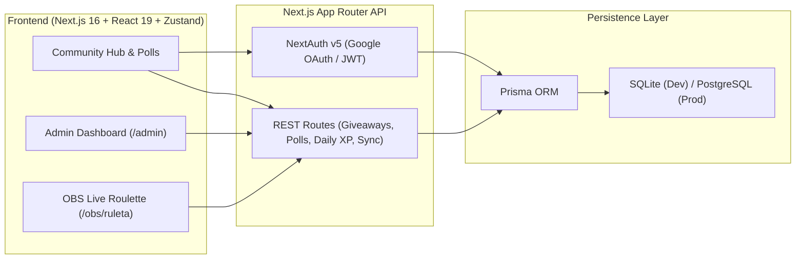

<div align="center">

# The Metiendole — MeteleNomas Community Platform

**Full-stack interactive community hub for the MeteleNomas streaming channel**, featuring user authentication, gamified XP/levels & daily streaks, live giveaways with an OBS-ready roulette overlay, community polls, clips, and an admin control panel.

[](https://github.com/fizsmx/the_metiendole/actions/workflows/ci.yml)
[](https://the-metiendole.vercel.app)
[](https://nextjs.org/)
[](https://www.typescriptlang.org/)
[](https://www.prisma.io/)
[](https://www.docker.com/)
[](./LICENSE)

</div>

---

## Key Features

- **Authentication & Role-Based Profiles** — Powered by **NextAuth v5** (Google OAuth + dev credentials) and Prisma Adapter with role tiers (`ADMIN`, `MODERATOR`, `VIP`, `MEMBER`), customizable nicknames, banners, Discord tags, and YouTube handles.
- **Gamification & Economy Engine** — Points & XP ledger (`PointTransaction`), level progression, daily check-in streaks (`/api/user/claim-daily`), achievements, and reward redemptions.
- **Giveaways & Live OBS Roulette** — Entry management with point/level eligibility checks, QR code support, and a dedicated transparent **OBS Browser Source roulette overlay** (`/obs/ruleta`) for live stream draws.
- **Interactive Community Polls & Feed** — Real-time community voting (`/api/polls/vote`, `/api/votar`), posts, comments, reactions, and stream clip submissions.
- **Admin Dashboard** — Centralized moderation and event management at `/admin`.
- **Containerized Workflows** — Dedicated `Dockerfile.dev`, `Dockerfile.prod`, and `docker-compose.yml` for reproducible local and production deployments.

---

## System Architecture



---

## Tech Stack

| Layer | Technologies |
| :--- | :--- |
| **Framework & UI** | Next.js 16 (App Router), React 19, TypeScript, Tailwind CSS v4, Framer Motion, Lucide Icons, Sonner |
| **State & Auth** | Zustand, NextAuth v5 (`@auth/prisma-adapter`) |
| **Database & ORM** | Prisma ORM (SQLite / PostgreSQL) |
| **DevOps & Deploy** | Docker, Docker Compose, Vercel |

---

## Getting Started

### Local Development

```bash
# 1. Clone the repository
git clone https://github.com/fizsmx/the_metiendole.git
cd the_metiendole

# 2. Install dependencies
npm install

# 3. Configure environment variables
cp .env.example .env

# 4. Initialize the database
npx prisma migrate dev
node prisma/seed.js

# 5. Start the development server
npm run dev
```

Open [http://localhost:3000](http://localhost:3000) in your browser.

### Docker

```bash
docker compose up --build
```

---

## License

Released under the [MIT License](./LICENSE).

<div align="center">
  Built by <a href="https://github.com/fizsmx"><strong>Fisbert Chavez (@fizsmx)</strong></a>
</div>
